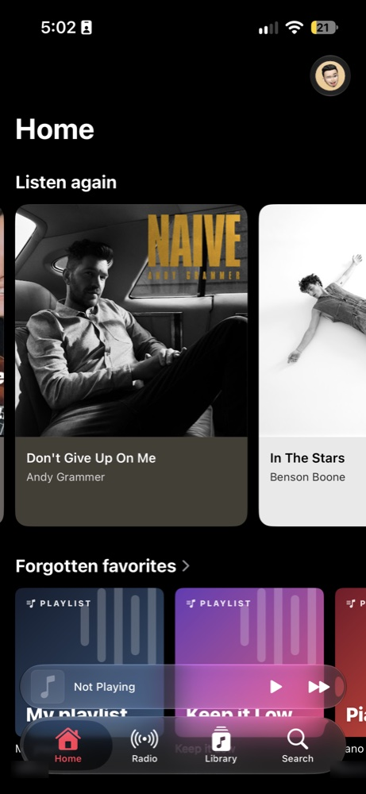
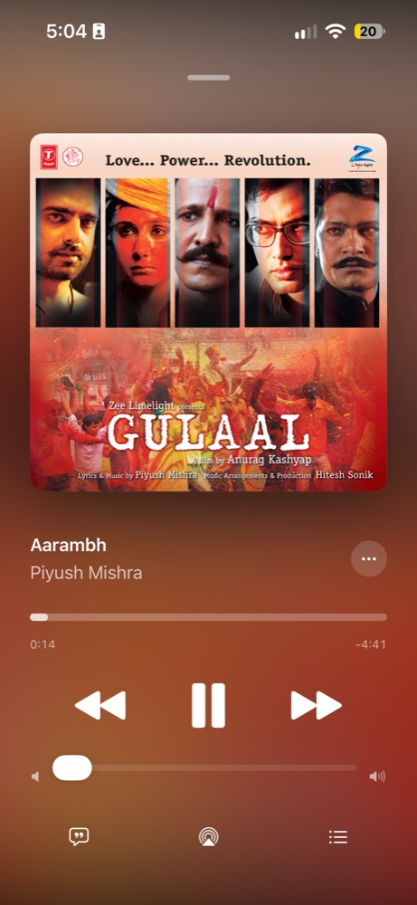
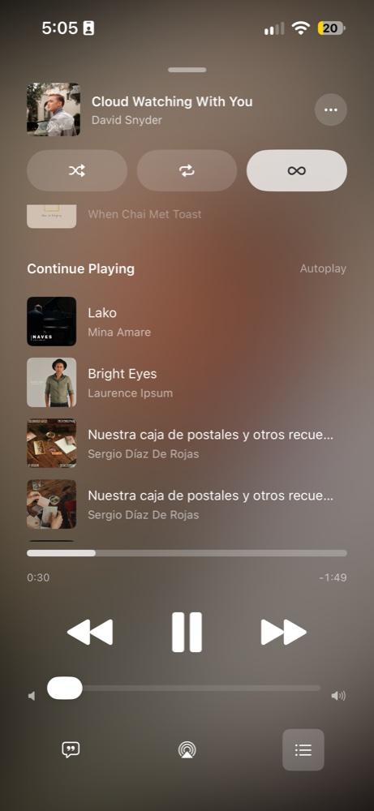
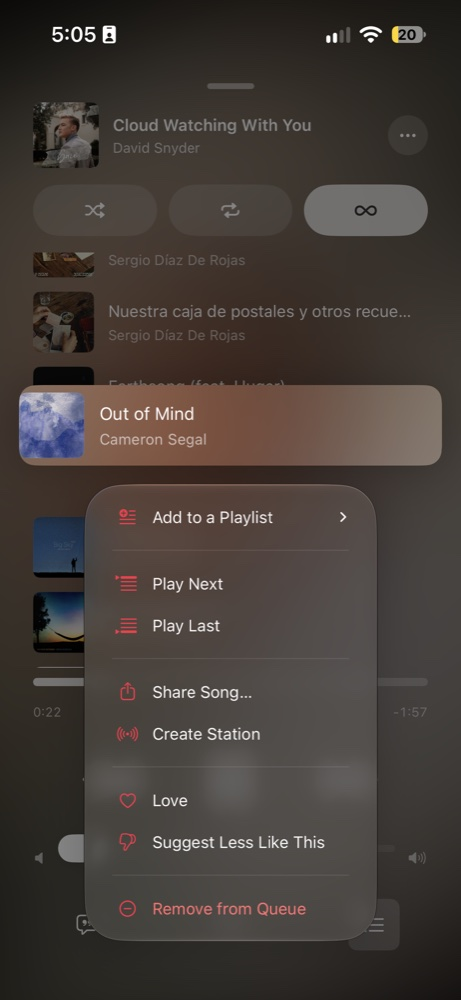
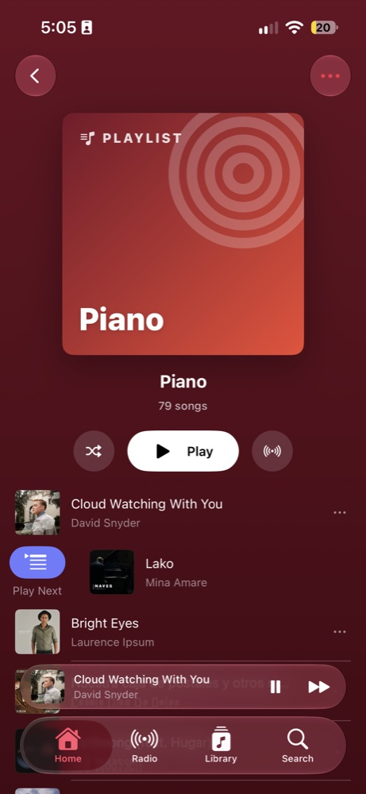
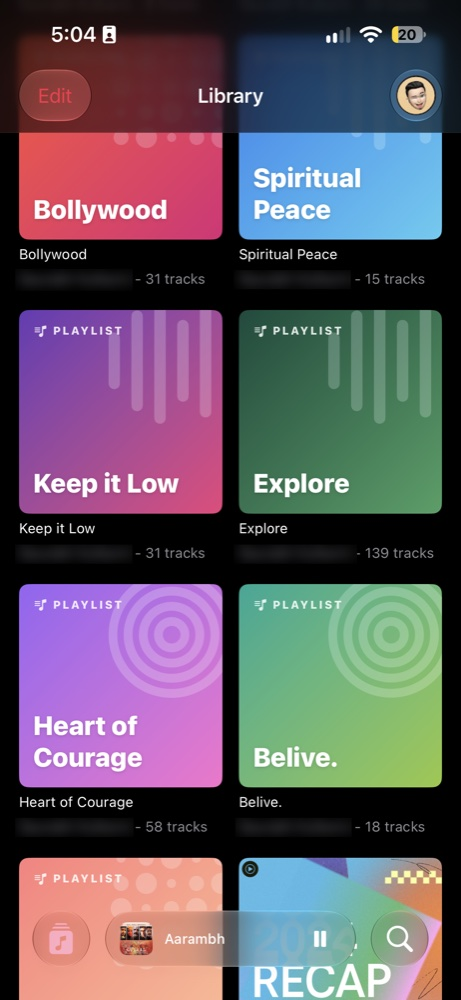
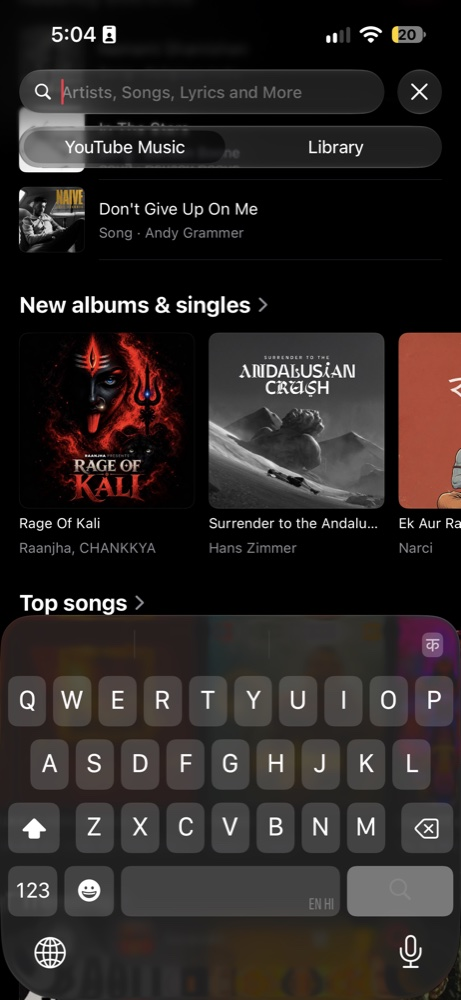
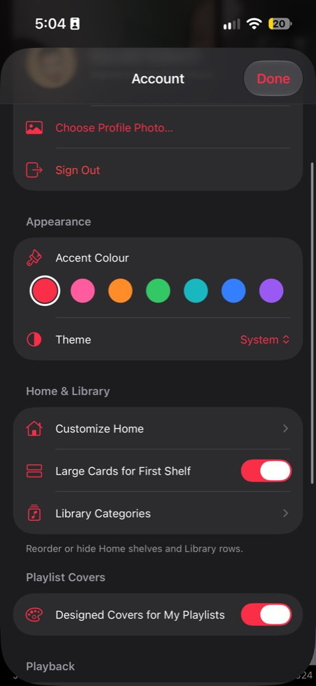

<p align="center">
  
</p>

<h1 align="center">AppleTube</h1>

<p align="center">
  An Apple Music–style iPhone app for your <b>YouTube Music Premium</b> account.<br>
  SwiftUI · iOS 26+ · Liquid Glass · no servers, no API keys, no passwords
</p>

---

AppleTube puts YouTube Music's catalogue, library and recommendations behind an interface modelled on Apple Music:
glass tab bar and mini player, artwork-tinted album pages, time-synced lyrics, a real queue, swipe actions and
long-press menus everywhere. Playback runs through YouTube Music's own web player, so Premium features (no ads,
background play, your quality settings) work as they do on music.youtube.com.

It's a personal project, built to be sideloaded onto your own iPhone with Xcode. It is not on the App Store.

## Screenshots

<table>
  <tr><td align="center"><br><sub>Home</sub></td><td align="center"><br><sub>Now Playing</sub></td><td align="center"><br><sub>Queue</sub></td><td align="center"><br><sub>Song menu</sub></td></tr>
  <tr><td align="center"><br><sub>Playlist</sub></td><td align="center"><br><sub>Library</sub></td><td align="center"><br><sub>Search</sub></td><td align="center"><br><sub>Settings</sub></td></tr>
</table>

## Features

**Listening**
- Now Playing with artwork-coloured animated background, scrubber, volume, AirPlay, Love and a full song menu
- Lock Screen and Control Center controls; keeps playing in the background and when the phone locks
- **Lyrics** like Apple Music: time-synced lines that scroll and highlight, tap a line to jump, breathing dots in
  instrumental gaps. Sources: YouTube Music's own timed lyrics, then [LRCLIB](https://lrclib.net) with fuzzy title matching
- **Queue**: History, Continue Playing, swipe to remove, Shuffle / Repeat / Autoplay, Play Next / Play Last for songs,
  albums and playlists

**Browsing**
- Home with your YouTube Music shelves (large "Top Picks" cards, reorderable and hideable)
- Radio, artist pages, album and playlist pages tinted with the artwork's colour
- Search with Recently Searched, suggestions, and a scope picker for all of YouTube Music or just your library

**Library**
- Playlists, Artists, Albums, Songs and Recently Added; choose and reorder the categories
- Like, add to library, add to playlist, create and delete playlists, remove songs from a playlist
- **Designed playlist covers**: every playlist you own gets a generated cover from a fixed set of palettes and
  motifs, editable per playlist (or keep the original artwork)

**Feel**
- Long-press context menus with previews and swipe actions on every song, matching Apple Music's menu structure
- Instant screens: responses are cached on disk, so pages paint immediately and refresh in the background
- Settings: accent colour, light/dark theme, profile photo, Home and Library customisation, storage clean-up

## How it works

```
┌─────────────── SwiftUI app ───────────────┐
│  Home · Radio · Library · Search · Player │
└──────┬─────────────────────────┬──────────┘
       │ data                    │ playback
       ▼                         ▼
 InnerTube API             hidden WKWebView
 (music.youtube.com/       running music.youtube.com
  youtubei/v1, signed      (YouTube's own player, queue
  with your web cookies)    and Media Session controls)
```

- **Sign-in** happens in a web view on Google's own page. The app never sees your password; it reuses the web
  session's cookies to sign InnerTube requests (`SAPISIDHASH`), the same way the website does.
- **Data**: InnerTube responses are parsed with parsers adapted from [Kaset](https://github.com/sozercan/kaset)
  (MIT), the macOS YouTube Music client.
- **Playback** happens in a hidden web view on music.youtube.com. The app drives it with JavaScript: switching
  tracks through the page's router and editing the queue through the real menu commands. YouTube's player handles
  Premium, ads and stream protection.

More detail in [docs/architecture.md](docs/architecture.md).

## Build and install

You need a Mac with Xcode 26 or later, an iPhone on iOS 26 or later, and a YouTube Music Premium account.
A free Apple ID is enough to sign the app.

```bash
brew install xcodegen
git clone https://github.com/PiratedVirus/AppleTube.git && cd AppleTube
cp Local.example.yml Local.yml   # set your team ID and a unique bundle ID
xcodegen generate
open AppleTube.xcodeproj         # pick your iPhone and press Run
```

Find your team ID in Xcode → Settings → Accounts. On the iPhone, turn on
**Settings → Privacy & Security → Developer Mode** the first time.

### Keep it installed (free Apple ID)

Apps signed with a free Apple ID stop opening after 7 days. A launch agent can rebuild and reinstall over Wi-Fi
before then:

```bash
Scripts/refresh_install.sh --force     # build the last commit and install it now
Scripts/install_refresh_agent.sh       # check hourly; reinstall 3 days before expiry
Scripts/install_refresh_agent.sh --remove
```

Your Apple ID must be signed in to Xcode, and the iPhone must have connected to Xcode at least once and be on the
same Wi-Fi as the Mac. The log is in `~/Library/Logs/AppleTubeRefresh.log`.

## Tests

```bash
xcodebuild test -project AppleTube.xcodeproj -scheme AppleTube \
  -destination 'platform=iOS Simulator,name=iPhone 18 Pro'
```

Unit tests check the parsers against recorded signed-out responses in `AppleTubeTests/Fixtures`; refresh them with
`python3 -I Scripts/capture_fixtures.py AppleTubeTests/Fixtures`. UI tests use the live service and cover navigation,
context menus, the cover editor and Settings.

## Limitations

- It depends on YouTube Music's private web API and web player. When YouTube changes them, things break until
  the parsers or scripts are updated.
- Downloads and offline playback aren't supported.
- Music videos show a frame of the video as their artwork.

## Credits

- [Kaset](https://github.com/sozercan/kaset) by sozercan: InnerTube parsers and models (MIT, notice kept in
  `AppleTube/YTMusic/Kaset/LICENSE.txt`)
- [LRCLIB](https://lrclib.net) for community time-synced lyrics

## Disclaimer

AppleTube is an independent personal project. It is not affiliated with, endorsed by or sponsored by Apple or
Google/YouTube. "Apple Music", "YouTube" and "YouTube Music" are trademarks of their owners. It needs your own
YouTube Music Premium subscription and uses your own signed-in session. Use it in line with YouTube's Terms of Service.

## License

[MIT](LICENSE)
